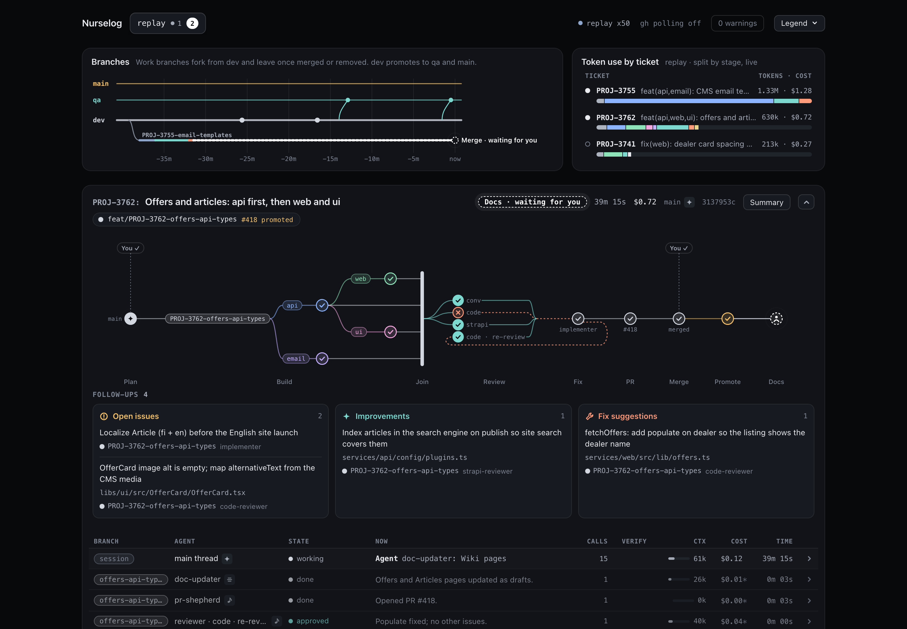

# Nurselog

A live, local board of your Claude Code sessions. It runs on `127.0.0.1` next to your terminal and shows, per session
and branch, which agents are running, where the work is in the loop (Plan, Implement, Join, Review, Fix, PR, Merge,
Promote, Docs), what waits for you and what it costs. Named after the nurse log, the fallen tree that feeds new growth.

**[Live demo](https://petterikorpimaa.github.io/nurselog/)**: the board replaying three sample sessions in your
browser, with nothing to install.

[](https://petterikorpimaa.github.io/nurselog/)

- **Live**: the plugin's hook records every Claude Code event, and the board updates as the events arrive.
- **What waits for you**: plan approvals, questions, open PRs and promotions stand out on the card, the tab and the app's Dock badge.
- **Cost**: tokens and USD per agent, stage, session and ticket, read from the session transcripts.
- **Local only**: no telemetry, no account, no runtime dependencies. The only network calls are the `gh` polls you turn on.
- **Nothing to commit**: a Claude Code plugin with its config outside the repository.
- **Any workflow**: a plain session already shows up; subagents, markers and `gh` fill in the rest.

## Quick start

Needs Node 24+, git 2.24+, Claude Code 2.1.292+ and macOS or Linux. `gh` is optional (PRs, merges, promotions). There
is nothing to build: the plugin ships the build.

1. **Install the plugin** for every repository:

   ```console
   claude plugin install nurselog --marketplace petterikorpimaa/nurselog
   ```

2. **Set up your repository.** Start `claude` in it and ask:

   ```text
   /nurselog:nurselog set up this repository
   ```

   Claude proposes a config from what the repository shows and writes it once you approve, under
   `~/.local/share/nurselog`, nothing in the repository. Then it offers the terminal command `~/.local/bin/nurselog`,
   which every example below uses ([Terminal command](#terminal-command)).

3. **Open the board.** It starts the board when it is not running and opens it, signed in; from then on a session start
   in the repository starts the board in the background when it is down. Until you add the PATH line `install-cli`
   printed, if it printed one, run `~/.local/bin/nurselog open` instead.

   ```console
   nurselog open            # or: nurselog open --app, for a window of its own
   ```

**Just looking?** After step 1, ask Claude `/nurselog:nurselog install the terminal command`, then replay the sample
sessions without setting up a repository and open the URL it prints (from a clone without the plugin,
`node ~/github/nurselog/bin/nurselog` in place of `nurselog`):

```console
nurselog start --replay web-only,api-first,handed-back --speed 50 --port 6799
```

## Load the plugin

| Way | How | Applies to |
| --- | --- | --- |
| Marketplace (recommended) | `claude plugin install nurselog --marketplace petterikorpimaa/nurselog` | Every repository, from the terminal, the IDE extensions and the desktop app (`~/.claude/settings.json`) |
| Every session, from a clone | `CLAUDE_CODE_PLUGIN_DIRS` in the `env` block of `~/.claude/settings.json` (`:`-separated paths) | Every repository, from the terminal, the IDE extensions and the desktop app |
| One session, from a clone | `claude --plugin-dir ~/github/nurselog` | That session |
| Per repository, from a clone | `claude plugin marketplace add ~/github/nurselog` once, then `claude plugin install nurselog@nurselog --scope local` in the repository | That repository (`.claude/settings.local.json`) |

The marketplace install runs a copy of the release from `~/.claude/plugins/cache/nurselog/nurselog/<version>/`; the
other ways load a clone in place. A clone loaded with `CLAUDE_CODE_PLUGIN_DIRS` or `--plugin-dir` replaces an installed
copy in the sessions that load it. `/plugin` in a session lists `nurselog` when it is loaded.

| The plugin | In every repository | In a set-up repository |
| --- | --- | --- |
| Skill `/nurselog:nurselog` (start the board, status, markers, config, setup) | yes | yes |
| Marker tools `plan`, `gate`, `question` | answer "not set up" | yes |
| `nurselog` on the Bash tool's PATH (your terminal's through the [terminal command](#terminal-command)) | yes | yes |
| Records every event to the spool | no | yes |
| Injects the markers and report-block instructions | no | yes |
| Starts the board when it is down | no | yes |

A set-up repository is one with a config ([Configuration](#configuration)). Nothing is added to `CLAUDE.md` or to the
agent files: the instructions are injected at SessionStart (main thread) and SubagentStart (agents whose role stage is
implement, review or pr).

<details>
<summary>From a clone</summary>

A clone runs the version you check out, for example to pin one. Any path works; the examples use `~/github/nurselog`:

```console
git clone https://github.com/petterikorpimaa/nurselog.git ~/github/nurselog
git -C ~/github/nurselog checkout v0.1.0      # optional: pin a release tag
```

Load it in every session from `~/.claude/settings.json`:

```json
{ "env": { "CLAUDE_CODE_PLUGIN_DIRS": "~/github/nurselog" } }
```

For the terminal, `node ~/github/nurselog/bin/nurselog install-cli` writes the terminal command on the clone (or use
the alias of "The terminal command by hand").

After a `git pull`, restart the board so that it runs the new build.

</details>

<details>
<summary>Update the plugin</summary>

```console
claude plugin update nurselog@nurselog
```

New sessions load the new version; a running session keeps the old one until `/reload-plugins` or a restart. The
board running from the old copy closes itself within 10 seconds, and the next session start starts the new one (or
run `nurselog open`). To update without asking, choose Enable auto-update for `nurselog` in `/plugin` > Marketplaces;
it is off for marketplaces outside Anthropic's. From a clone: `git pull`, then restart the board.

</details>

<details>
<summary>Remove the plugin</summary>

A Claude Code plugin uninstall removes the plugin only: the terminal command, the recorded data and what you added by
hand stay. To remove everything, close your other Claude Code sessions first (their hooks keep recording and can
restart the board until they end), then run in a terminal outside Claude Code, where the command refuses to remove the
plugin under a running session:

```console
nurselog uninstall
```

It prints its plan and asks before it removes anything (`--yes` skips the question). It stops the board, deletes the
terminal command, the recorded data of every repository (a `spool.dir` elsewhere included) and
`~/.local/share/nurselog`, then runs `claude plugin uninstall nurselog@nurselog` and
`claude plugin marketplace remove nurselog`, or prints them when `claude` is not on PATH or Nurselog runs from a clone.
The data stays while a board it could not stop runs, and `~/.local/share/nurselog` stays when the purge failed; a
failed run ends with the command to run it again. `--keep-data` keeps the data, the configs and the board token for a
later reinstall. It never edits what you added by hand: it lists the lines of your shell profiles that name Nurselog,
the `env.CLAUDE_CODE_PLUGIN_DIRS` and `env.NURSELOG_*` entries and a `statusLine.command` that names Nurselog in
`~/.claude/settings.json`, each repository config and the board app, for you to remove. Without the terminal command,
run
`node ~/.claude/plugins/cache/nurselog/nurselog/<version>/bin/nurselog uninstall`, or from a clone
`node ~/github/nurselog/bin/nurselog uninstall`.

By hand, the same in this order:

1. Delete the terminal command while the plugin is still installed: `nurselog install-cli --remove`. After the
   uninstall it finds no copy to run, so then delete `~/.local/bin/nurselog` by hand.
2. Uninstall the plugin and remove the marketplace. From a clone, delete the `CLAUDE_CODE_PLUGIN_DIRS` entry from the
   `env` block of `~/.claude/settings.json` instead.

   ```console
   claude plugin uninstall nurselog@nurselog                    # the marketplace install
   claude plugin marketplace remove nurselog                    # the marketplace
   ```

   A board running from the uninstalled copy closes itself within 10 seconds; a board started from a clone keeps
   running, so stop it with `kill <pid>` (the pid `nurselog status` prints). Claude Code deletes the uninstalled copy
   under `~/.claude/plugins/cache/nurselog/` after 14 days.
3. Delete the recorded data, the user configs, the board token and the log, which cannot be undone:
   `rm -rf ~/.local/share/nurselog` ([Data and retention](#data-and-retention)).
4. Remove what you added yourself:
   - a shell function or an alias from your shell profile; keep the `~/.local/bin` PATH line when other commands use
     it (Claude Code's native install puts `claude` there);
   - a status line command and `NURSELOG_*` variables from `~/.claude/settings.json` or the shell profile;
   - a repository config `nurselog.config.json` that `nurselog init --repo-file` wrote;
   - the board app, if you installed it, from the browser or the Dock ([Opening the board](#opening-the-board)).

`claude plugin uninstall nurselog@nurselog --scope local` removes the plugin from one repository only and keeps all of
the above.

</details>

### Terminal command

The plugin's `nurselog` is on the Bash tool's PATH only. For your terminal, `nurselog install-cli` writes a small
script, `~/.local/bin/nurselog`: the skill offers it after setting up a repository, and
`/nurselog:nurselog install the terminal command` asks for it at any time.

- From a marketplace install it runs the newest installed copy that no update or uninstall has replaced, so it needs no
  rewrite after `claude plugin update`; from a clone it runs that clone.
- It runs `node` from your PATH, and it never edits a shell profile: when `~/.local/bin` is not on your PATH it prints
  the line to add to `~/.zshrc` or `~/.bashrc`, `export PATH="$HOME/.local/bin:$PATH"`.
- A file at that path that `install-cli` did not write is never replaced or removed. `nurselog install-cli` again
  updates the script, and `nurselog install-cli --remove` deletes it.

<details>
<summary>The terminal command by hand</summary>

Instead of `~/.local/bin/nurselog`, add a shell function to `~/.zshrc` or `~/.bashrc`, then open a new shell. It runs
the newest installed copy of the plugin:

```sh
nurselog() {
  local copy
  copy=$(command ls -d ~/.claude/plugins/cache/nurselog/nurselog/[0-9]*.[0-9]*.[0-9]*/ 2>/dev/null | sort -V | tail -1)
  [ -n "$copy" ] || { echo 'nurselog: the plugin is not installed' >&2; return 1; }
  node "${copy}bin/nurselog" "$@"
}
```

From a clone, an alias on the clone does the same:

```sh
alias nurselog='node ~/github/nurselog/bin/nurselog'
```

</details>

## What the board shows

| Element | Shows |
| --- | --- |
| Repository tabs | One per set-up repository with activity in the last 7 days, with running and waiting counts. The page title and the app's Dock badge carry the total waiting count. |
| Top bar | Connection (`live`, `replay x50`), gh status, warnings, legend. |
| Branches | Trunk and promote lines, one lane per work branch coloured by stage, merges and promotions, a time axis up to 24 h. |
| Token use by ticket | Tokens and cost per ticket key (else branch), split by stage. |
| Session card | One per session that runs a subagent, edits files or opens a PR. Hovering a lane or ranking row lights its card. |
| Card header | Ticket key and title, a progress chip (what works or waits), elapsed time, cost, model, session id (click to copy for `claude --resume`), fixture download, Summary. |
| Graph | Plan, then per branch the Implement streams, Join, Review, Fix, PR, Merge, Promote and Docs, with "You" gates and question bubbles. Each `plan` starts a new pipeline. |
| Questions | Questions waiting for you, blocking ones marked, with their options. |
| Follow-ups | Open issues, improvements and fix suggestions from the agents' reports. |
| Agent table | One row per agent: state, current tool, calls against budget, verification passes and fails, context, cost, time. A row expands to its recent calls and report. |
| Main thread and log | The newest main-thread message (all of them in a dialog) and the newest log line. |
| Tokens by stage | A stacked chart per stage and package. |
| Summary | Per agent totals, cost by branch, tool output, verification commands, and each resume after a pause with its context, whether the prompt cache likely expired and Claude Code's cache write estimate. |
| Conversations | Sessions that only chat, one row each. |
| Finished | Done sessions fold here after 2 minutes; Show, Clear, Undo. |

<details>
<summary>URL parameters</summary>

- `?repo=<tab name>` opens a repository's tab (default: the most recently active).
- `&session=<id>` scrolls to one session's card once.
- `?view=runs` shows the older view with one card per run.

</details>

## How it works

```text
Claude Code --hook--> spool (NDJSON day files) --read--> board server (reducer) --SSE--> browser
                                                               ^
                                   git, gh, transcripts -------+  (facts, written back to the spool)
```

- **Hook** (`hooks/nurselog-hook.mjs`): runs on 19 Claude Code events, drops file and output bodies, redacts the rest
  and appends one line. It always exits 0, so it never fails a session.
- **Spool**: one NDJSON file per day under `~/.local/share/nurselog/<repo-hash>/`, shared by every worktree of a clone.
  It is the source of truth: while the board is down nothing is lost, and the next start replays it.
- **Board server**: one process for every repository on `127.0.0.1:6767`. It reads the last 7 days, follows new lines,
  reduces them to session state and pushes snapshots over Server-Sent Events.
- **Facts**: branches and fork points from `git`, PRs from `gh`, tokens and cost from the transcripts and
  `prices.json`. Written back to the spool, so a replay rebuilds the same board.
- **Markers**: what hooks cannot see (the plan, hand-overs to you, questions asked in prose), added by the main thread
  through the plugin's tools.
- **UI**: vanilla TypeScript and SVG, no framework. Node 24 built-ins only, no runtime dependencies.

### Workflow stages

| Stage | Starts when |
| --- | --- |
| Plan | The main thread gets its first prompt. Waits on a `gate plan`, AskUserQuestion or a blocking question. |
| Implement | An agent with an implement role (`implementer`) makes its first call. One stream per package or planned stream. |
| Join | The main thread writes the branch diff for the reviewers (`join.pattern`, default `git diff <trunk>...HEAD >`). |
| Review | An agent with a review role starts. A `fix` follow-up in its report means changes, otherwise approved. |
| Fix | After a review asked for changes: an implementer or a main-thread edit. The same reviewer again is a re-review. |
| PR | A pr role (`pr-shepherd`) starts or the main thread runs `gh pr create`. |
| Merge | From `gh`: waits while the PR is open, done when merged. With `github.mergeBy: agent`, waits only on a `gate merge`. |
| Promote | From `gh`: waits while a PR into a `branches.promote` target carries the change. |
| Docs | A `docs.roles` agent or a `docs.tools` call. Waits on a `gate docs`. |

### What each part needs

| You get | With |
| --- | --- |
| Session cards, agent table, tokens and cost, Summary, questions from AskUserQuestion and permission prompts, branch lanes, insights | The plugin and a config |
| Implement streams, Review and Fix stages, follow-ups, reviewer verdicts | Agent roles: the default agent names (`implementer`, `code-reviewer`, `pr-shepherd` ...) or the config `roles`, which `init` fills from `.claude/agents` |
| Stream order, the plan note as title, plan and docs gates, prose questions | Markers (the injected instructions tell the main thread to add them) |
| PR titles and states, Merge and Promote stages | `gh` logged in and `github.repo` set |
| Ticket keys from prompts as well as branch names | `keyPattern` |
| Lower-case tracker keys in branch names (Linear's `user/eng-123-fix-login`, Shortcut's `sc-123`) | `keyPattern` in upper case (`ENG-\d+`) and `keyIgnoreCase: true` |
| Ticket keys as links to the tracker | `keyUrl` |
| Package streams and colours | `packages` |
| Budget bars (calls and verify rounds) | `budgets` (default: implementer 80 calls, 3 verify rounds) |

When a repository's loop differs, the board draws what it can derive and leaves out the rest:

- No Bash call matches `join.pattern`: no Join node. A reviewer that starts anyway still gets its node.
- The main thread works without implementer subagents: no Implement streams, and its edits show as Fix nodes of the
  agent `main`.
- No pull requests, or no `github.repo`: no Merge gate, because Merge and Promote come from `gh`.
- A subagent that works in its own worktree (a `pr-shepherd` that checks out an existing branch) begins a run there
  that starts at its stage, PR or Implement, and has no Plan.
- A role that `roles` maps to `other` (the `*` fallback, the built-in `general-purpose` among them) gets no reviewer
  node. It becomes an Implement stream of the branch at its first file edit in a feature worktree, or in the main
  checkout on a feature branch, but without the report block below; one that only reads stays under the Plan node.
- A reviewer that reads several branches (their files by path, or `git diff main...<branch>`) is a reviewer node on
  each of their rows.
- The stages above are fixed: a workflow with other stages cannot be drawn.

<details>
<summary>Roles and the report block</summary>

- The config `roles` maps an agent type to `{ "stage": "implement" | "review" | "pr" | "other", "short"?: "<label>" }`;
  the fallback `*` is required and is `other` by default. A stage `build`, the old name of `implement`, is still
  read as `implement`. An `other` agent appears in the agent table and under the Plan node, until its first file edit
  on a branch makes it an Implement stream there.
- Default roles: `implementer` implements; `conventions-checker`, `code-reviewer`, `spec-reviewer`,
  `typescript-reviewer`, `security-reviewer`, `design-reviewer`, `database-reviewer`, `silent-failure-hunter` and
  `pr-test-analyzer` review; `pr-shepherd` opens the PR. Any other agent type needs its own entry in `roles`;
  `nurselog init` writes one for each agent in `.claude/agents` whose name is `implementer`, `builder`, `developer`,
  `coder` or `engineer` or ends in `-` plus one of them or in `-dev` (implement), is `reviewer`, `qa` or `tester` or
  ends in `-reviewer`, `-checker`, `-analyzer`, `-hunter`, `-qa` or `-tester` (review) or ends in `shepherd` (pr). An
  implement name whose `tools` list has none of `Edit`, `Write`, `MultiEdit`, `NotebookEdit` and `Bash` is read-only
  and gets none. Any other agent gets an implement role when its `tools` key lists `Edit`, `Write`, `MultiEdit` or
  `NotebookEdit`, except the names in `docs.roles` (default `doc-updater`); an agent without a `tools` key inherits
  every tool and gets no role from them.
- Agents with an implement, review or pr role get an injected instruction to end their report with a fenced `nurselog`
  YAML block: `decisions`, `followups` (`issue`, `improve` or `fix`, with text and an optional file), `questions` and
  `files`. It feeds the follow-ups, the reviewer verdicts and the questions with the main thread.

</details>

## Opening the board

- `nurselog open` starts the board when it is down, signs the browser in with a single-use ticket and opens it.
  `--app` opens it in a Chromium window without tabs or address bar.
- The browser stays signed in (a cookie) across board restarts. One that is not shows "This browser is not signed in
  to the board. Run `nurselog open` to open it here."
- One board serves every set-up repository, one tab each.
- Stop a foreground `nurselog start` with Ctrl+C, a background board with `kill <pid>` (`nurselog status` prints the
  pid).

<details>
<summary>Auto-start and auto-open</summary>

The first session in a set-up repository starts the board in the background when it is down, and says so once:

- `Nurselog board started: http://127.0.0.1:6767/`
- `Nurselog board is starting; log: ~/.local/share/nurselog/board.log` when it is not up within 1.5 s
- `Nurselog board did not start; see ...` with the start command when it ended at once

The board keeps running after the session ends. Its output goes to `~/.local/share/nurselog/board.log`, overwritten
at each such start. It inherits the session's environment without `GIT_*`, `CLAUDE*`, `ANTHROPIC_*`, `GH_TOKEN`,
`GITHUB_TOKEN` and their enterprise forms, and so does a board that `nurselog open` starts. If `gh` is logged in only
through `GH_TOKEN`, run the board in a terminal with `nurselog start` instead. A board closes itself within 10 seconds
when the plugin copy it runs from is replaced by an update or uninstalled, or when the worktree of a clone that
started it is removed; the next session start starts a new one.

| Variable | Effect |
| --- | --- |
| `NURSELOG_AUTO_START=0` | No auto-start; sessions get the start command instead. |
| `NURSELOG_AUTO_OPEN=app` | The session that started the board also opens it in an app window, once (macOS and Linux). |

Set them where Claude Code reads its environment: the shell profile, the `env` block of `~/.claude/settings.json`
(which also reaches IDE and desktop sessions), or a project's `.claude/settings.json` for one repository. When no
Chromium browser launches, or the board is still starting after 1.5 s, the session's message gets the line
`nurselog open --app` instead.

</details>

<details>
<summary>Sign-in, the token and <code>open</code></summary>

The board's data is behind a token, so another user of the machine cannot read it.

- The token is `~/.local/share/nurselog/token` (mode 0600), made by the first live board start. It never appears in a
  URL.
- `nurselog open` and the auto-open ask the board for a single-use ticket, valid for 60 seconds, and open
  `http://127.0.0.1:6767/?ticket=...`, which sets the cookie and drops the ticket from the address bar. The ticket stays
  out of the process list (`ps`), where another user could redeem it first: an app window opens a local file,
  `~/.local/share/nurselog/signin-<random>.html` (mode 0600), that only redirects to the ticket URL, and the macOS
  default browser gets the URL through `osascript`'s standard input. On Linux, `xdg-open` and a snap browser still
  get the ticket URL as an argument, so there the board redeems a ticket only for a connection of your own user: a
  sign-in it refuses leaves the page signed out and a `sign-in refused: <reason>` line in the board's log.
- A foreground `nurselog start` in a terminal prints a ticket URL, valid once for 10 minutes. Without a terminal (a
  log, a pipe) it prints the plain URL and `sign in with: nurselog open`. A replay always prints its ticket URL.
- `nurselog link` and `nurselog status` print the URL without a ticket: a signed-in browser needs none.
- To rotate the token: delete the file, restart the board, run `nurselog open`. While a board runs whose token is not
  the file's, `status` and `link` say `board token missing or changed; restart the board`, and `open` and `start`
  refuse with the reason.
- `nurselog open` waits up to 5 seconds for the board and opens the default browser (`osascript` on macOS, `xdg-open`
  on Linux). `--app` uses Google Chrome, Microsoft Edge, Brave Browser or Chromium (on Linux `google-chrome`, `chromium`
  or `microsoft-edge` on PATH) and falls back to the default browser with a line that says so. Elsewhere it prints
  the URL.

</details>

<details>
<summary>Install the board as an app</summary>

The board can run in a window of its own, with a Dock icon whose badge counts what waits in every repository. Open the
board with `nurselog open` (or a foreground `start`'s ticket URL), then:

- Chrome or Edge: the install icon at the right of the address bar, or the browser menu (Chrome: "Cast, save, and
  share"; Edge: "Apps").
- Safari (macOS 14 and later): File > Add to Dock.

The app is bound to the address, the port included: install it from `127.0.0.1` on the board's usual port, not from
`localhost` or a fallback port. It opens only while the board runs.

</details>

<details>
<summary>Board link in the Claude Code status line</summary>

`nurselog link [--session <id>] [--osc8]` prints the repository's tab URL, with `&session=<id>` for one session;
`--osc8` makes it a terminal hyperlink named "Nurselog". When no board serves the repository it prints nothing on
stdout and exits 1, so the status line stays empty. The example calls the [terminal command](#terminal-command) by its
path, which works whether or not `~/.local/bin` is on the status line's PATH:

```sh
#!/bin/sh
# statusLine command: the session's board link after the model name
input=$(cat)
id=$(printf '%s' "$input" | jq -r '.session_id')
model=$(printf '%s' "$input" | jq -r '.model.display_name')
link=$(~/.local/bin/nurselog link --session "$id" --osc8 2>/dev/null)
printf '%s %s\n' "$model" "$link"
```

</details>

<details>
<summary>Ports, tabs and a second start</summary>

- The board listens on 6767, or the next free port up to 6786, and writes `~/.local/share/nurselog/server.json` (pid,
  port, start time). `--port <n>` picks one port with no fallback; a `server.port` in a config is ignored with a
  warning.
- It finds repositories by the record the hook writes for each set-up repository
  (`~/.local/share/nurselog/<repo-hash>/repository.json`), at start and every 10 seconds. Tabs are alphabetical,
  named by the checkout's directory.
- While a board runs, a second `start` starts nothing and prints the URL of the current repository's tab
  (`http://127.0.0.1:6767/?repo=acme-shop`); `--repo <path>` names another repository.
- After a plugin update the old board closes itself and the next session start runs the new one; after a `git pull`
  of a clone, restart the board so that it runs the new build.
- A config change needs a board restart.

</details>

## Markers

The main thread adds what hooks cannot see. The injected instructions tell it to use the plugin's tools, each only
when its case comes up (working alone, it may need none):

| Tool | Records |
| --- | --- |
| `plan` | The run's streams (`id`, `package?`, `after?`, `model?`) and a note, when the work goes to subagents in streams. A new plan starts a new pipeline. |
| `gate` | A hand-over to you: gate `plan`, `merge`, `promote` or `docs`, state `waiting`, `done` or `skipped`. |
| `question` | A question asked in prose: `text`, `blocking`, `options`, and `relays` only for a subagent question it passes on. Returns an id; `answer: <id>` closes it. |

`run` defaults to the run the session started in; pass it only for work in another worktree. Claude Code asks for
permission on each tool's first use; a plugin cannot pre-approve it. Joins, reviews, merges and promotions are derived
and need no marker.

<details>
<summary>Markers from a terminal: <code>nurselog emit</code></summary>

```console
nurselog emit plan --run acme-shop-3762 --stream api --stream web:after=api
nurselog emit gate --run acme-shop-3762 --gate docs --state waiting
nurselog emit question --run acme-shop-3762 --text 'Keep the legacy slug?' --blocking --option Keep --option Drop
nurselog emit question --run acme-shop-3762 --text 'Which port should the api use?' --relays q-a1b2c3-2
nurselog emit question --run acme-shop-3762 --answer <question id>
```

- `--run` is the worktree name; `--repo <path>` names the repository when the current directory is not in it.
- A relayed question id is `q-<agent id>-<n>`, n its position in that agent's report block, from 1.
- Free text goes in single quotes: the shell runs a `$(...)` inside double quotes before `emit` sees it.
- Text you did not write yourself (a ticket, a report, a page) goes through stdin, as a JSON object with `text`,
  `note`, `context` and `options`, or as plain text for the main field:

  ```console
  nurselog emit question --run acme-shop-3762 --blocking --stdin <<'EOF'
  {"text": "Keep the legacy slug?", "options": ["Keep", "Drop"]}
  EOF
  ```

- A value that starts with `-` needs the `=` form: `--text='-5 files'`.

</details>

## Commands

| Command | Does |
| --- | --- |
| `nurselog start [--port <n>]` | Runs the board in this terminal (the default command). |
| `nurselog start --replay <a,b> [--speed <n>]` | Replays fixtures; needs no config. |
| `nurselog open [--app]` | Starts the board when needed and opens it, signed in. |
| `nurselog status` | Board pid and URL, spool directory, lines today, this repository's tab. |
| `nurselog link [--session <id>] [--osc8]` | This repository's board URL, for a status line. |
| `nurselog init [--write] [--repo-file] [--from -]` | Proposes a config, or writes it. Never overwrites a file. |
| `nurselog emit plan\|gate\|question ...` | Adds a marker. |
| `nurselog insights [--json]` | Workflow health report. |
| `nurselog fixture <session id> [--out <file>]` | Exports a session as a replay fixture (prompts, answers, commands and reports included, so check it before you share it). |
| `nurselog purge [--before <day>] [--all] [--yes]` | Deletes recorded data. |
| `nurselog install-cli [--remove]` | Writes the [terminal command](#terminal-command) `~/.local/bin/nurselog`, or deletes it. |
| `nurselog uninstall [--yes] [--keep-data]` | Removes Nurselog from this machine and lists what you added by hand ("Remove the plugin" under [Load the plugin](#load-the-plugin)). |
| `nurselog help` | Usage. |

Every command except `open`, `install-cli`, `uninstall` and `help` takes `--repo <path>`; the default is the git
worktree of the current directory.

## Configuration

Nurselog records a repository only when it has a config. The first of these is used, merged over the defaults (objects
key by key, arrays and scalars replace):

1. **User config** `~/.local/share/nurselog/<repo-hash>/nurselog.config.json`: outside the repository, written by
   `nurselog init --write`. A symlink or another user's file is refused.
2. **Repository config** `nurselog.config.json` at the repository root, for a team that commits it (`init --write
   --repo-file`). A linked worktree without it uses the main checkout's.

The defaults name no project: trunk `main`, no promote targets, no packages, no GitHub repository (so no `gh` polling).
Set only what differs:

```json
{
  "keyPattern": "PROJ-\\d+",
  "branches": { "trunk": "dev", "promote": ["qa", "main"] },
  "github": { "repo": "acme/acme-shop", "promoteTitlePrefix": { "qa": "Promote dev to qa", "main": "Promote dev to main" } },
  "packages": [{ "id": "api", "color": "#8cb4ff", "paths": ["services/api"] }],
  "budgets": { "roles": { "code-reviewer": { "toolCalls": 40 } } }
}
```

`nurselog.config.example.json` shows the repository sections for a multi-package monorepo. An invalid file leaves the
repository off the board with a warning; a bad value of a known key falls back to its default with a warning.

<details>
<summary>What <code>nurselog init</code> detects</summary>

`init` proposes only what it can read; everything it leaves out keeps its default.

- `branches.trunk` from `origin/HEAD`, else a local `main` or `master`.
- `github.repo` from a `github.com` `origin` URL (SSH or HTTPS).
- `github.accountPattern` as `^<login>$` from `gh api user` when `gh` is installed. Left out with `--repo-file`, because
  a committed login would turn polling off for every other contributor.
- `packages` from `pnpm-workspace.yaml` or the `workspaces` of `package.json` (`dir/*` expands one level to the
  directories with a `package.json`; the id is the directory name; colours from a fixed palette).
- `roles` from `.claude/agents/*.md`: `implementer`, `builder`, `developer`, `coder`, `engineer`, `*-` plus one of
  them and `*-dev` implement, unless an explicit `tools` list has no file-writing tool and no `Bash` (read-only);
  `reviewer`, `qa`, `tester`, `*-reviewer`, `*-checker`, `*-analyzer`, `*-hunter`, `*-qa` and `*-tester` review;
  `*shepherd` opens the PR. Any other agent whose `tools` list `Edit`, `Write`, `MultiEdit` or `NotebookEdit` implements
  too, except the exact names in `docs.roles` (default `doc-updater`); an agent without a `tools` key is left to its
  name.
- `keyPattern` as `<PREFIX>-\d+` when at least 3 of the 50 most recent branches carry a ticket key with one shared
  prefix. With a `keyPattern` the key also comes from prompts, as a whole word that is never part of a path or URL.
  When no upper-case prefix qualifies but one does in any case (`eng-123`), it proposes the prefix in upper case with
  `keyIgnoreCase: true`.

Without `--write` it prints the JSON and `Would write: <path>`. With `--write` it writes the user config (directory
0700, file 0600), or with `--repo-file` the repository config (0644). It never overwrites a file: when the target
exists it prints the path and exits 1. A user config replaces a repository config as a whole, and `init` says so when
it writes one next to the other. `--from -` reads a complete proposal from stdin, checked like a config file; the
skill `/nurselog:nurselog` uses it after refining the proposal with you from the repository's `CLAUDE.md`,
`AGENTS.md`, agents and skills.

</details>

<details>
<summary>Every config key</summary>

`*` marks keys read only from the user config; a repository config that sets one gets a warning and the default.
Arrays such as `packages` replace the default list whole.

| Key | Default | Meaning |
| --- | --- | --- |
| `keyPattern` | `""` | Ticket key regex. Empty: the key comes from the branch name only. |
| `keyIgnoreCase` | `false` | `keyPattern` (written in upper case) matches in any case and the key is stored in upper case: `eng-123` gives `ENG-123`. Ignored without `keyPattern`. |
| `keyUrl` | `""` | Ticket link: the ticket keys on the board link to the ticket, each `{key}` replaced by the key, e.g. `https://tracker.example/browse/{key}`. `https:` only, with `{key}` outside the host, else a warning and plain keys. Empty: keys are plain text. |
| `branches.trunk` | `"main"` | The trunk branch. |
| `branches.promote` | `[]` | Promote targets; the Promote stage is drawn only with one. |
| `github.repo` | `""` | `owner/name`, the repository a git remote of this repository points at (a fork may name its `upstream`); otherwise the top bar shows `gh repo mismatch`. Empty turns `gh` polling off. |
| `github.accountPattern` | `""` | Regex the `gh` login must match. Nurselog never switches accounts; from the user config it can poll with a logged-in account that is not the active one. |
| `github.pollSeconds` | `60` | 10 to 3600. Polls only while a browser is open and the repository has an open run. |
| `github.mergeBy` | `"developer"` | `agent`: an open PR does not wait for you. |
| `github.promoteTitlePrefix` | `{}` | PR title prefix per promote target; required for each target. |
| `packages` | `[]` | `{ id, color, paths[], label? }`, up to 50. An implementer with no package is in the stream `repo`. |
| `stageColors` | built in | Hex colour per `plan`, `implement`, `review`, `fix`, `pr`, `docs`, `wait`; the old key `build` is still read as `implement`. |
| `roles` | see "Roles and the report block" | Agent type to `{ stage, short? }`; `*` required. |
| `docs.roles` | `["doc-updater"]` | Agents that put a run in Docs. |
| `docs.tools` | `[]` | Tool names that put a run in Docs. |
| `modelLetters` | Haiku H, Sonnet S, Opus O, Fable F | Short model label per model prefix; the longest prefix wins. |
| `budgets.warnAt` | `0.8` | Share of a budget that turns the bar to a warning. |
| `budgets.default` | no limits | `{ toolCalls, verifyRounds }` for every role. |
| `budgets.roles` | implementer 80 calls, 3 rounds | Per role budgets. |
| `budgets.contextLimits` | 200k, 1M for current models | Context window per model prefix. |
| `verification.runners` | pnpm, npm, npx, yarn, bun, node, turbo, make, tsc, eslint, vitest | Commands that can be verification runs. |
| `verification.kinds` | typecheck, lint, test | Regex per kind; the test default takes `npm test`, `yarn test`, `bun test` and `make test`. |
| `verification.failPatterns` | per kind | Matched against the kept stdout tail; the test default reads vitest's, Jest's and bun's failed counts. Only the default runners and kinds keep a tail. |
| `verification.fullRunOnly` | `true` | A run with a path argument is not a full run. |
| `join.pattern` | from the trunk | Regex of the main-thread command that writes the reviewers' diff. |
| `pricesFrom` `*` | `prices.json` of the plugin | Token prices in USD per million tokens per model prefix. |
| `spool.dir` `*` | `~/.local/share/nurselog` | Absolute or `~/`; not the home or root directory, not inside the repository. |
| `spool.readDays` `*` | `7` | Days the board reads at start. |
| `spool.keepDays` `*` | `14` | Days of day files kept. |
| `spool.maxLineBytes` `*` | `65536` | Longest spool line. |
| `insights.window` / `baseline` / `minBaseline` | `5` / `20` / `10` | Work sessions compared by `insights`. |
| `insights.keepDays` `*` | `365` | Days the session aggregates are kept. |
| `retention.indexHours` | `6` | In-memory index retention of the reducer. |
| `features.answerFromUi` | `false` | Answering from the board is not built yet. |

Configured regexes are capped at 200 characters and run on V8's linear-time engine, so a pattern cannot hang the
board.

</details>

## Security and privacy

- **Loopback only**: the board binds `127.0.0.1`. A request with another `Host` gets 403, and so does an API request
  from a foreign `Origin` or with `Sec-Fetch-Site: cross-site`.
- **Token**: every API route but the health check needs the board token (a bearer header or a cookie derived from it),
  so other users of the machine cannot read the board. The browser signs in with a single-use ticket.
- **Minimal recording**: the hook drops file contents, edit bodies and tool output, and redacts secrets before
  anything is written.
- **Private files**: directories 0700, files 0600, opened without following symlinks.
- **No telemetry**: nothing leaves the machine except the `gh` calls of a repository whose config sets `github.repo`.
- **No runtime dependencies**: Node built-ins only; the hook and the marker tool server are plain ESM.

<details>
<summary>What the hook keeps, drops and redacts</summary>

Kept: prompts, commands, file paths, tool names, agent types and reports, timings, token counts, and your answers and
notes to the main thread's AskUserQuestion calls (up to 10 per call, 500 characters each, redacted by shape).

Dropped:

- Edit and Write bodies (kept as character counts only).
- Tool output, except its length, a few scalars, the first error line (300 characters), a failed call's error cut
  to 500 characters and an AskUserQuestion call's answers and notes (above).
- Everything but the path and the command for calls that touch a secret (`.env*`, `.npmrc`, `.netrc`, `*.pem`,
  `*.key`, `id_*`, `credentials*`, `hosts.yml`, paths with `secret`, `printenv`, `env`, `gh auth token` ...); such calls
  are marked `sensitive` and keep no error.

Redacted, before any cut: values of secret-named keys, PEM, SSH and age keys, about 30 token shapes (`sk-`, `ghp_`,
`github_pat_`, `AKIA`, JWTs, Slack tokens ...), long base64 runs, URL passwords, auth headers, `--password`-style flag
values and `NAME=value` pairs with a secret name. The home directory becomes `~`.

The stdout tail: a command made only of verification runs (default runners and kinds, such as `pnpm test:run`,
`npm test` or `make test`) keeps its last 300 characters, and `gh pr create` its PR URL. The rule is an allowlist (no
option between the runner and its tool word, only allowlisted environment names such as `CI` and `NODE_ENV`, no long
`grep` option). The tail is redacted by shape only, so a value a test prints can survive in it, and a script that loads
`.env` itself is not seen as touching a secret. A `make` tail holds make's echo of the recipe lines with their variables
expanded, so prefix a recipe line that carries a secret with `@`. `make` keeps no tail when an option or a `NAME=value`
follows it (`make -j4 test`, `make test V=1`), and keeps none unless every target is a kind target (`test`, `lint`,
`test:unit`, `lint-ci`); the verification round still counts.

AskUserQuestion answers and notes are redacted by shape as well, so a secret you type that has no known shape can
survive. One guard covers the plain case: when a question asks for a password, passphrase, secret, API key or token,
access or auth token, private key or credential, also by a name such as `DB_PASSWORD` (a token budget does not count),
its answer is kept only when it is one of the call's offered options, and its notes always become `[redacted]`;
anything you typed there becomes `[redacted]`.

</details>

<details>
<summary>Server, token and external calls</summary>

- Headers on every response: `Content-Security-Policy: default-src 'self'; frame-ancestors 'none'; base-uri 'none';
  form-action 'none'`, `X-Content-Type-Options: nosniff`, `Referrer-Policy: no-referrer`,
  `Cross-Origin-Resource-Policy: same-origin`; API responses also `Cache-Control: no-store`.
- The token is 32 random bytes. The cookie (`HttpOnly; SameSite=Strict`) holds an HMAC of the port under the token, not
  the token, so it is valid on that port only; both are compared in constant time. A sign-in ticket lives 60 seconds in
  memory (10 minutes when `start` prints it). A replay uses a random in-memory token.
- Before a client sends the token, the board proves it holds it (an HMAC over a nonce, its port and its pid).
- `gh` runs only when `github.repo` is set: `gh pr list` polls while a browser is open and the repository has an open
  run, plus `gh api user` and `gh auth status`. Nurselog never switches accounts. From the user config it may poll
  with a logged-in account that is not the active one, through `gh auth token --user <login>` passed to that poll's
  process only, never logged or written.
- `git` runs with hooks and fsmonitor disabled and `--end-of-options`; branch names are validated first.
- A board started in the background (auto-start or `nurselog open`) drops the `GIT_*`, `CLAUDE*`, `ANTHROPIC_*` and
  GitHub token variables of the environment it starts from.
- Config files are read with a size limit (256 KiB), without following symlinks; another user's user config is refused.

</details>

## Data and retention

Everything lives under `~/.local/share/nurselog/`, one directory per repository (`<repo-hash>`, shared by its
worktrees).

| Data | File | Kept |
| --- | --- | --- |
| Events | `<repo-hash>/events-YYYY-MM-DD.ndjson` | 14 days (`spool.keepDays`); the board reads 7 (`spool.readDays`) |
| Session aggregates for `insights` | `<repo-hash>/aggregates.ndjson` | 365 days (`insights.keepDays`), pruned while a board runs |
| Repository record and user config | `<repo-hash>/repository.json`, `nurselog.config.json` | Until you delete them |
| Board token, `server.json`, `board.log` | top level | The token until deleted, `server.json` while the board runs, the log until the next background start |
| Sign-in files | top level, `signin-<random>.html` | Each redirects once to a single-use ticket URL; removed at the next sign-in once older than 60 seconds |

```console
nurselog purge                         # this repository's day files and aggregates (asks first)
nurselog purge --before 2026-10-01     # only the days before 1 October
nurselog purge --all --yes             # every repository and orphaned spool directory, without asking
```

<details>
<summary>Pruning, orphaned spools and backups</summary>

- The board and the hook delete day files older than `spool.keepDays`, and their `notified/` markers, once a day. The
  hook leaves `aggregates.ndjson` alone, so aggregates are pruned only while a board runs.
- An aggregate holds numbers, roles, tool and branch names, PR numbers, the ticket key and the session title, which can
  be the first line of the first prompt (up to 60 characters).
- `purge` lists per repository the tab, the number of day files and their first and last day, the number of
  aggregates and the directory, then asks `Delete N day files and M session aggregates? [y/N]`. Without a terminal it
  deletes nothing unless `--yes` is given. A running board keeps what it already read until it restarts.
- An orphaned spool (its checkout moved or gone, no day file of today) is pruned by the board once a day by its own
  user config's `spool.keepDays` and `insights.keepDays`, and taken whole by `purge --all`, listed as `(checkout moved
  or gone)` or `(no repository record)`. The directory, its record and its config stay until you delete them. A
  `spool.dir` outside the default root is not reached for such a repository.
- On macOS the spool directory is excluded from Time Machine once, by the hook's first prune or `init --write`; the
  file `.backup-excluded` records it. Undo with `tmutil removeexclusion <dir>`; Nurselog does not set it again while
  the file exists.
- With `spool.dir` set, the day files, aggregates and markers move there; the token, `server.json`, the repository
  record and the user config stay under the default root.

</details>

## Workflow health

`nurselog insights` shows where your workflow sticks, per area (Implementers, Review, Verification, Token economy,
Questions and waits): the last 5 work sessions against the up to 20 before them. It reads only the session aggregates,
so it needs no running board.

```markdown
- ! Implementers: 6 of the last 9 implement runs reached their tool-call budget by their first stop (67 %; the rule flags 30 % or more; before: 9 of 31).
- Review: 2 of the last 5 branches ran a second review round (before: 6 of 20).
- Verification: not measured: no command matched verification.kinds in the last 5 work sessions.
```

<details>
<summary>How the report is counted</summary>

- A flagged line (`!`) is a standing rule (such as 30 % or more implement runs at their budget) or a comparison
  worse than before by a fixed rule (a rate 1.5 times the earlier one, a median above the earlier 75th percentile).
  Every line carries its numbers and the earlier ones; there is no score.
- A work session is a session card with at least 5 main-thread tool calls. The board writes one aggregate per session
  it has seen finish; its first start backfills `spool.readDays` days.
- The first comparison comes after 10 earlier work sessions; until then a line reads `(before: fewer than 10 work
  sessions)`.
- An implement run is a subagent of an implement-stage role (`roles`), or any other subagent from its first file edit on
  a branch; the main thread's own verification commands are not one.
- A signal whose input your workflow lacks (no budget for the implement runs, no review roles or report blocks, no
  command matching `verification.kinds`) reads "not measured" with the reason and never flags.
- Failed runs are a non-zero exit or a fail pattern matching the stdout tail; with other runners than the defaults
  only exit codes count.
- `--json` prints the same lines with their numbers.

</details>

## Troubleshooting

| Symptom | Fix |
| --- | --- |
| "This browser is not signed in to the board" | `nurselog open` |
| `nurselog: command not found` in a terminal | Ask Claude `/nurselog:nurselog install the terminal command`, or add `~/.local/bin` to your PATH with the line `install-cli` printed ([Terminal command](#terminal-command)). |
| A session is not on the board | Does `/plugin` list `nurselog`, and does `nurselog status` show the repository as set up? A terminal tab opened before `CLAUDE_CODE_PLUGIN_DIRS` was exported does not have the variable. |
| "Nurselog is not set up for this repository" | `nurselog init --write` |
| `board token missing or changed; restart the board` | Stop the board (`kill <pid>`) and run `nurselog open`. |
| No PRs, merges or promotions | The top bar shows why: `gh polling off` (no `github.repo`), `gh account mismatch` (log in to an account that matches `github.accountPattern`; Nurselog never switches), `gh repo mismatch` (`github.repo` names no git remote of the repository; fix it, or the remote, after a rename) or `gh: <error>`. |
| The board still shows the old version (after an update, or after a `git pull` of a clone) | Stop it with `kill <pid>` (`nurselog status` prints the pid); the next session start starts it from the current copy. |
| The board did not start | Read `~/.local/share/nurselog/board.log`. |

## Limits

- Answering a question from the board is not built: its option buttons are disabled, so answer in the terminal.
- macOS and Linux only.
- Costs are estimates from `prices.json` (dated by `pricesDate`); set `pricesFrom` in the user config for your own.
- The board is for the local machine only, by design: no LAN or remote access.

## Feedback

Issues in this repository are welcome. The code is developed in a separate repository, so pull requests here are not
merged.

## License

[MIT](LICENSE). The board ships the fonts Inter and JetBrains Mono under the SIL Open Font License 1.1, with their
license texts in `src/ui/fonts/`.
